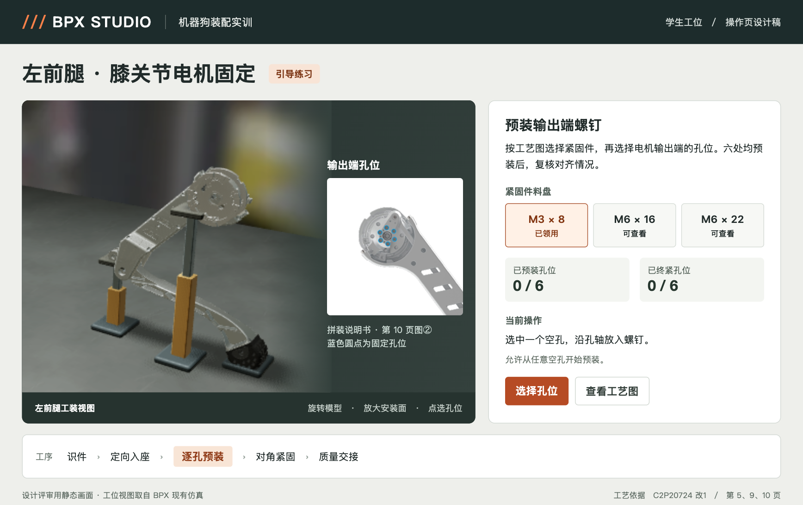

# BLACK PANTHER X 机器狗装配教学建设方案

**V1.1 评审稿 · 2026 年 11 月 21 日**　适用对象为机械制造、机电一体化及机器人相关专业的电脑实训课。本文供专业教师、产品、三维和开发团队共同评审。

## 1. 建设目标

学生能根据 BLACK PANTHER X 的工艺图，在电脑上独立完成一处膝关节电机的识件、定向入座、六孔预装、对角紧固和交检，并在换侧考核中发现一处装配缺陷，学生可核对自己的交检结论和分项成绩。

## 2. 首期交付边界

- **学生交付一张工单。** 工件从指定腿位的大腿组件开始，到膝电机输出端的六处固定点完成交检为止。大腿抱箍、髋电机和侧摆组件属于下一张工单。这一阶段的交检仅代表可以移交下道工序。
- **学生可从演示进入独立考核。** 含分步演示、左前工位练习、右前换侧考核、异常工件和个人过程记录。首发面向鼠标键盘和本地机房。
- **后续范围。** 单腿其余工序、四腿上机和电池锁合按现有章节扩展。校级账号、跨校数据平台、VR 和实机联动可另行立项。扭矩与制造公差的定量考核以受控工艺文件和合适的测量依据为前提。

## 3. 项目依据与市场调研

### 现有工程能教什么

| 证据状态 | 现场或资料核对结果 | 对方案的影响 |
|---|---|---|
| 已核验 · 页面实操 | 从「行走」入口切到「装配」，可选择躯干与电控盒、拼装四条腿、四腿装入躯干、安装电池。腿部章节显示 48 个运行步骤。点击唯一的膝电机候选并执行安装，就可进入显示六颗正确 M3×8 的第二步。 | 学生容易沿正确名单完成。练习需要混合料盘，考核需要让学生自己定向、选孔和判定是否齐套。 |
| 已核验 · 工程 | 工程说明记录 303 个 CAD 几何实例、108 颗补建螺钉和 1 个补建电池盒体。紧固件表有左前膝电机的六个独立实例、所属零件、落座点和轴线。已有夹具、轨迹检查、螺钉偏移与倾角、受阻回退。膝电机现从夹具已对齐的位置开始入座。 | 复用原模型及判定，新增混合备料、方向选择和每孔的工艺状态。首课无需从头建立机器狗。 |
| 已核验 · 原厂说明书 | 《260715拼装说明书_C2P20724改1》封面起计，第 5 页区分 KNEE、HIPY、HIPX，并规定多螺钉先全部预装、确认对齐、再对角拧紧。第 8–10 页给出 L/R 钢印、左腿领料、箭头面入槽和六颗 M3×8。第 16 页可核对右前腿及其六处紧固。 | KNEE 为通用膝电机。换侧考的是腿件钢印及装配位置，不能把同规格 KNEE 实例误判为左右专用。初版按工序、部位和数量评分。 |
| 已核验 · 教学逻辑 | 现有步骤会等待动作提交，也能撤销。六颗正确螺钉按已接受实例计数，文字提示对角拧紧，步骤逻辑未区别「仅预装」与「已终紧」。现有浏览器会话存储用于图库返回位置，装配过程未见学生工单和评分记录。 | 在动作提交处记录孔位状态与评价证据，个人工单区分选材错误、工序错误和漏检。 |
| 待试教 | 按一课时 45 分钟、每人一台电脑设计。铭牌、箭头和六孔在目标机房的显示尺寸、学生用时及教师讲评时间需要实测。 | 用同一台低配机和初学者先验证近景点选及独立操作，再确定班级推广节奏。 |

图示及工序可直接核对[随项目提供的原厂说明书图页](../../public/training/whole/)。工程定位见 [课程及说明书页码](../../public/assets/procedures.json)、[紧固件与孔位](../../public/assets/fasteners.json)、[章节推进规则](../../src/procedures.js)、[视口与操作提交](../../src/main.js)、[配合检测](../../src/collisions.js)。

### 五个产品给本课的具体启发

调研采用供应商产品页和四足机器人原厂手册，覆盖国内职教考核、机械技能测评、虚拟教学、工业工艺编制及教育型机器狗。样本反映公开可核实的设计做法，销量和市场份额没有纳入评价。

| 产品及可核实的做法 | BPX 采用的设计决策 |
|---|---|
| 亚龙 YL-326 将机械装配虚拟仿真、技能训练和信息化考核用于机电专业实训。 [亚龙官方产品页](https://www.yalong.cn/yljy/jycp/jdcp/2021/01/21/269649.html) | 同一工位能练习、能考核，学生可核对自己的分项成绩。 |
| Amatrol 27-MEA1 在机械传动工位上评价安装、调整等可观察技能。 [Amatrol 官方产品页](https://amatrol.com/product/mechanical-drives-1-assessment-workstation/) | 把「掌握膝关节装配」拆成有证据的动作，如选对料、对准安装面、完成六处固定。 |
| Cortona3D RapidLearning 用同一 3D 程序支持观察、交互练习和无提示技能测试，可记录学员表现。 [RapidLearning 官方产品页](https://www.cortona3d.com/en/rapidlearning) | 三种模式共享工艺规则，分别控制步骤提示、正确件高亮和成绩提交。 |
| PTC Illustrate 能从 CAD 工程数据制作插图和交互步骤序列，并维护与原设计的关联。 [PTC 官方产品页](https://www.ptc.com/en/products/arbortext/ptc-illustrate) | 每个训练动作关联 BPX 的实物实例、局部视角和说明书页码。改版时能定位受影响工单。 |
| Petoi Bittle 用分总成图、物料和方向特征教装配，另设校准与最终固定工序。 [Bittle 框架装配](https://bittle.petoi.com/3-assemble-the-frame) · [校准](https://bittle.petoi.com/6-calibration) | 借用「识别特征—分总成装配—检查」的教学结构。BPX 的零件、顺序和检验条件均取自自身资料。 |

## 4. 课程、工位与建设阶段

### 课程如何覆盖整机

| 课程单元 | 学生承担的任务 | 可交接的结果 | 建设顺序 |
|---|---|---|---|
| 腿部拼装 | 辨认左右件、核对电机类型、选安装面和紧固件，再完成抱箍及线扣 | 首件输出端的六孔记录，扩展后为单腿交检单 | **先做左前膝电机，再换右前考核**，通过试教后补同腿其余工序 |
| 躯干与电控盒 | 分辨长短梁和 M6×22、M6×16，装框架、电控盒及支撑件 | 型材孔位、入槽方向、分组紧固检查单 | 第二批，复用选料和多孔紧固能力 |
| 四腿上机 | 把各腿放入 LF、LR、RF、RR，依据前后位置核对侧摆输出轴、抱箍和线扣 | 腿位、轴向和固定情况记录 | 第三批，侧别与安装方向迁移到整机 |
| 电池装入 | 依工艺准备姿态、翻把手、沿槽推入、处理卡阻并锁合 | 入座与锁合记录，附一次卡阻返修轨迹 | 可用既有五步章节作附加短练，再补独立交检 |

### 一张可交付给学生的工单

**工单 LF-K01 · 安装左前腿膝关节电机输出端。** 你收到左前腿工位的备料盘，请查图领取零件，把电机装入指定腿件，完成输出端固定，并决定这件工件能否交给抱箍装配工位。桌面提供左右大腿、可辨类型的电机及三种本机螺钉。练习中可随时查图，工艺资料始终可用。

| 环节 | 学生在电脑上做什么 | 系统依据什么判断 | 典型错误与反馈 |
|---|---|---|---|
| 识件领料 | 旋转左右大腿查看钢印，放大电机铭牌，从料盘领用紧固件并选择数量 | L 钢印、KNEE 类型、M3×8 六颗分别核对，按规格管理可互换件 | 选了 HIPY 时，练习可提示「查看电机标签的前四位」，学生自行换料 |
| 定向入座 | 对照第 9 页点出箭头面与大腿下端安装槽，选择朝向，沿夹具导向进给 | 方向选择和目标槽吻合，原有轨迹检查通过，动作到位后提交 | 反面接近时保留工件姿态，可切换局部视角、退回和翻面 |
| 逐孔预装 | 放大输出端，在任一空孔试入螺钉，选择内六角工具，完成每孔预装 | 每孔独立记录规格、工具类别、轴线检查结果和预装状态。支持任意起孔 | 错规格返盘，倾斜啮入时停在当前工位。对同一孔重复操作不会增加数量 |
| 对齐与终紧 | 完成六孔预装后检查配合面，依对角关系分组逐一拧紧 | 六孔均已预装、已完成对齐检查、所选孔组与复核后的对角配对一致 | 只预装五孔就尝试终紧，显示「此工件尚有空孔」，学生自己定位；程序保留已预装的五孔 |
| 交检与返修 | 读图核查安装面和固定点，在工件上标记异常位置，选择「可移交」或「返修」，返修后复检 | 学生判定与工件真实状态一致。缺件、未终紧、错误安装方向均阻止合格交接 | 面对外观已装好的工件，学生需发现例如「一孔仍为预装」，补做后再签交检单 |

六孔的预装顺序自由。终紧允许从任意孔开始，由机械教师按孔位图和 CAD 复核三组对孔，配置允许的等效顺序。所有同型合格件按物料规格匹配，到实际安装时才绑定孔位。螺钉啮入沿用项目的几何和教学阈值。鼠标操作评价图纸理解、工序选择及复核能力。实物工具手感、真实扭矩另在实训台评价。

交检时切换到独立工件，先由学生选孔，再用「查此孔紧固记录」核对该孔的预装和终紧签记。漏钉可从空孔直接看出，有螺钉但缺终紧签记则需列为待复检，返修工位执行确认或补紧。示教可显示六孔总览，考核只返回学生主动检查的孔位记录。

### 一节 45 分钟的课

| 分钟 | 教师与学生 | 课堂产出 |
|---|---|---|
| 0–5 | 教师展示外观相近的两条腿，学生看钢印和工单确定领取哪一件 | 一次课前识件判断 |
| 5–10 | 教师投屏示范一个孔的预装，转动模型展示箭头面、配合面和孔轴 | 学生说出六孔未预装齐时为什么应暂缓终紧 |
| 10–25 | 学生完成左前工位，可查图、看分级提示、退回和重试 | 左前首件及自己的错误记录 |
| 25–37 | 换右前工位独立考核，隐藏正确件列表、自动对轴和答案高亮，保留原厂图、物料标识和局部放大 | 一张独立装配工单 |
| 37–45 | 学生检查待交接件，定位缺陷、判断是否返修并完成复检 | 一次独立缺陷判定和返修记录 |

### 学生工位

图中为学生已领用 M3×8、尚未预装第一孔的**静态评审稿**。左侧采用现有项目视口实拍，旁边是第 10 页的局部图。学生可看清自己在装哪一面、图纸指的是哪一组孔、当前有多少孔已预装。侧栏主操作随工序切换为「选孔」「预装」「终紧」「提交交检」，无需离开三维工位。

| 学习模式 | 进入与操作 | 退出时能拿到什么 |
|---|---|---|
| 工序演示 | 逐步观看领料、入座、紧固和交检操作，可随时查阅工艺图 | 理解工序顺序、孔位和安装基准 |
| 学生引导练习 | 一级提示定位资料页，二级显示基准特征，三级演示本步。点模型或用键盘选择等价的中性孔号 | 每项操作结果、提示使用及可单独重练的工序 |
| 学生独立考核 | 显示交付要求、工艺资料和可选工具与材料。打乱料盘位置，提供可读铭牌和必要的视角辅助 | 已提交的工单、判定、分项分数及返修结果 |

### 评价办法与一个算例

建议满分 100 分，80 分及以上且最终交检合格为通过。首次错误保留用于讲评，学生能用返修证明最终质量。建议试教时核对下表的难度和分布。

| 评分项 | 分值 | 可复算的证据 |
|---|---:|---|
| 备料识件 | 20 | 正确腿件、电机类型、螺钉规格、领料数量各 5 分，按首次正式提交的领料单计 |
| 定向与入座 | 20 | 安装面、安装槽各 5 分，首次方向正确 5 分，最终无阻入座 5 分 |
| 预装与终紧 | 35 | 每个已预装的不同孔得 2 分，共 12 分。预装齐后复核对齐且首次终紧时机正确得 8 分。三组对孔各首次按认可次序终紧得 5 分 |
| 质量交接 | 25 | 缺陷工件的首次「可移交／返修」结论 5 分，正确定位孔位及原因 10 分，完成返修后通过复检 10 分 |

**个人工单样例。** 一名学生首次领错规格（备料 15/20），方向正确（20/20），五孔时试图终紧，退回找到漏孔，随后三组对孔顺序正确（27/35）。独立交检时找到预置的未终紧孔并完成返修（25/25）。记录显示 **87/100，交检合格**。个人工单记录领料提交、提前终紧被阻、补装及复检四个事件。随意转动视角、浏览材料和放大图纸均不扣分；重复点击同一动作按事件去重。

### 工程实现与估算

以当前 Three.js、Rapier、本地静态发布为基础。课程配置单独保存任务版本、说明书版本和页码、备料候选、允许的等价件、孔位、工具、前置工序、提示、评分项与缺陷初态。首期编制两个腿位共享的一个任务模板。工艺负责人审核模型特征、可接受路径和缺陷后发布版本；修改后的规则产生新版，历史成绩按原版解释。

操作层先试算选材、方向和路径，再由现有运动逻辑报告受阻、回退或完成。每孔有「空孔、预装、终紧」三种状态，最终位姿与工艺状态分别记录。动作完成后更新工件，失败尝试也记入学习记录。退出、刷新和撤销可以恢复到最后一次已完成的操作，撤销以新事件保存。学生代号、工单版本、尝试编号、孔位、动作、判定、提示及时间写入本地存储，同次考核的重复提交不产生第二份成绩。学生可下载个人工单留存。

下表为首轮排期估算，按一名主开发、一名三维技术人员协作，机械教师与教学设计参与评审、测试人员复核。每个小阶段按 1–2 个工作日安排，串行约 **7–14 个工作日**。需补建几何或调整机房设备时，在实测后重估。

| 阶段 | 工作 | 可当场演示的结果 |
|---|---|---|
| 1 · 最难的一孔 | 核对钢印、箭头和孔面，准备一个可反向的工件，核实低配机上点选与偏斜拒绝 | 学生能看见识别特征，完成正确入座并复现一次反装或偏斜 |
| 2 · 识件与领料 | 整理混合料盘，配中性名称和真实标识，绑定等价料件和分级提示 | 学生能自己判断 L/R、KNEE 和螺钉规格 |
| 3 · 六孔工序 | 标定六孔和对角配对，加入预装、对齐检查、终紧及回退 | 五孔时会被挡住，补齐后可从不同起孔完成 |
| 4 · 左前工单 | 接入课程入口、说明书局部图、就近镜头和交接状态 | 一张引导工单可以从领料做到交接 |
| 5 · 换侧与缺陷 | 配置右前考核、隐藏答案提示、准备未终紧缺陷和正常对照件 | 学生按工件实际状态判断是否需要返修 |
| 6 · 成绩与续做 | 实现事件记录、幂等提交、同版本恢复和报告导出 | 刷新后继续，成绩与原动作序列逐项吻合 |
| 7 · 机房试教 | 回归原入口与原章节，在目标机器上走课，按观察调整镜头、提示和评分 | 学生可独立选题、练习、交检并查看成绩 |

## 5. 实施风险与处置

| 风险 | 处置与负责人 |
|---|---|
| CAD 不含足够清晰的铭牌、钢印或箭头，学生只能猜方向 | 三维人员按说明书制作可核对的局部贴标和近景，教师逐项签认。标记来源和左右语义随工单版本保存。 |
| 六孔难点选，学生成绩反映鼠标精度 | 提供正视安装面、放大图与中性孔号列表，键盘和鼠标共用同一判定。测试时故意选择相邻孔，验证放大后可独立区分。 |
| 现有螺钉绑定固定安装位，容易把「选物料」退化为点正确实例 | 开发在备料阶段按规格计数，安装时再绑定目标孔。用两个可交换的同规格件、两种起孔顺序做等价性测试。 |
| 用模型估算值给出过度精确的结论 | 工艺教师只发布可溯源的规则。首期仅判几何和工序状态，定量扭矩需补充厂家数据及测量方法后另设题。 |
| 整机视角看不清缺陷，或答案由提示泄露 | 预置实际状态可复现的缺陷。考核用中性控件、允许查图。终检需同时提交部位与原因，教师用正常对照件复核误报。 |
| 机房换机、清理浏览器或课程换版导致记录丢失或成绩混用 | 学生交卷时下载带版本和尝试编号的个人工单。恢复旧任务使用原版规则，缺少旧版时保留原报告。 |

## 6. 待试点确定的事项

| 决策 | 建议初值 | 由谁、何时确定 |
|---|---|---|
| 课时与受众基础 | 以学过机械制图、未接触 BPX 的学生为首批对象，每人 45 分钟 | 任课教师在试教后用实际耗时调整 |
| 合格线和等效终紧顺序 | 先用 80 分加交检合格，接受任意起孔及经审核的三组对孔顺序 | 专业教师在考核版发布前审核 |
| 参考图的呈现 | 校内评审样张使用手册局部图，正式课件核定图示使用范围，必要时用项目 CAD 重绘 | 项目负责人在分发课件前确认 |
| 成绩交付 | 进度在本机续做，学生可下载个人成绩 | 课程负责人和学校信息部门在试点后决定 |

## 7. 验收与扩建条件

- [ ] 让评审者分别选择左件、右件、错误电机、错误规格、反向和正确入座。系统逐项给出可定位的结果。通用 KNEE 可以用于两个腿位。
- [ ] 对六个孔各做一次预装，重复同孔、错轴和仅预装五孔就终紧均保持正确计数。至少两条经审核的等效终紧顺序可完成交检。
- [ ] 正常件可移交，至少两种故障样件（缺钉、仅预装）必须定位并返修后才能合格。复算同一记录，分项和总分一致。
- [ ] 在独立考核中逐个检查列表、键盘导航、悬停提示和自动对轴入口，均不泄露下一正确对象。正式图纸、标签和放大工具可正常使用。
- [ ] 在六孔中途刷新、受阻回退、撤销及连续两次交卷。工件状态及历史完整，同一尝试只计一次成绩。
- [ ] 在学校一台典型机和一台最低配置机上，以 1366 × 768 完成全课，操作区、工件、提交按钮均可达。预装阶段抽测 60 秒，目标中位帧率至少 30 fps，低于目标时先优化局部场景再试。
- [ ] 试教建议 1 位机械教师、8 名目标学生。至少 6 人在 12 分钟内完成换侧独立装配、在末段检验中正确识别缺陷。未通过的项回到对应工序调整，再决定是否铺开四章。
